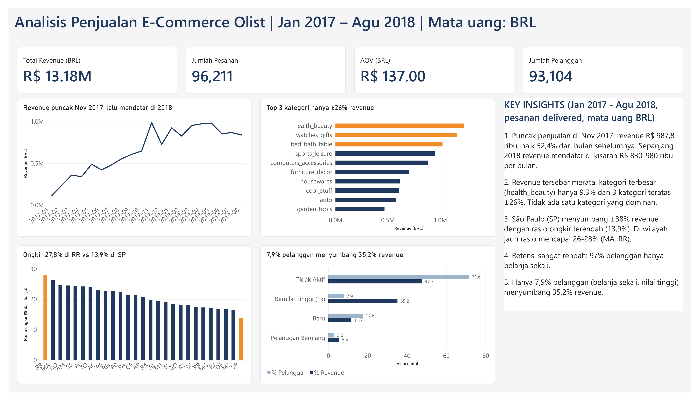
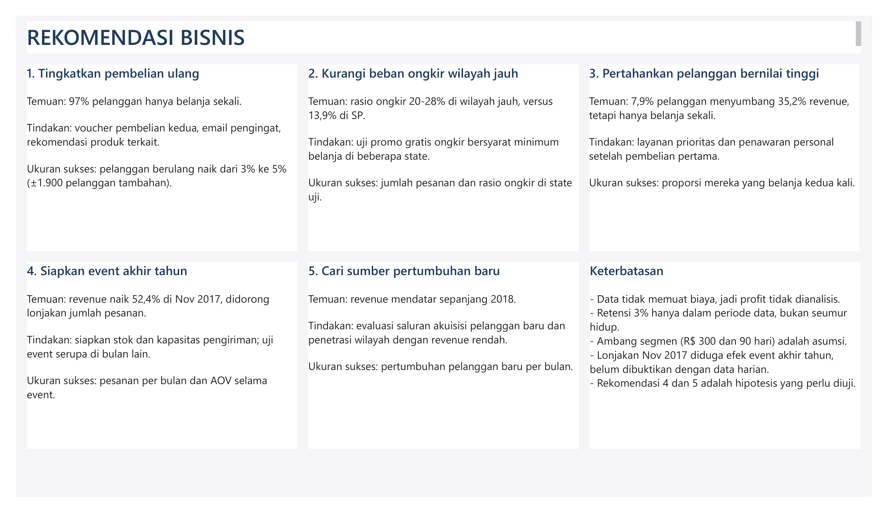

# Analisis Penjualan E-Commerce Olist (SQL + Power BI)

Analisis 96.211 pesanan e-commerce Brasil (Jan 2017 – Agu 2018) untuk memahami tren penjualan, kategori dan wilayah terbaik, serta perilaku pelanggan. Proyek ini memakai SQL untuk eksplorasi, cleaning, dan analisis, lalu Power BI untuk dashboard.



## 1. Masalah Bisnis

**Stakeholder:** Kepala Penjualan.

Pertanyaan yang dijawab:
- Bagaimana tren penjualan selama 20 bulan?
- Kategori produk apa yang paling bernilai?
- Wilayah mana yang paling terbebani ongkir?
- Seberapa banyak pelanggan yang kembali belanja, dan siapa yang paling bernilai?

## 2. Data

- **Sumber:** [Brazilian E-Commerce Public Dataset by Olist (Kaggle)](https://www.kaggle.com/datasets/olistbr/brazilian-ecommerce)
- **Tabel yang dipakai:** `orders`, `order_items`, `customers`, `products`, `category_translation`
- **Mata uang:** Real Brasil (BRL)
- **Periode analisis:** Januari 2017 – Agustus 2018, hanya pesanan berstatus `delivered`

Data mentah tidak disertakan di repository ini (ukurannya besar dan sudah tersedia publik di Kaggle).

## 3. Proses Cleaning

| Temuan | Keputusan |
|---|---|
| Tidak ada duplikat `order_id` | Tidak ada tindakan |
| 96.478 dari 99.441 pesanan berstatus `delivered` (±97%) | Hanya `delivered` yang dihitung sebagai penjualan |
| Data 2016 sangat sedikit, dan November 2016 kosong | Dikeluarkan |
| Sep 2018 hanya 16 pesanan dan Okt 2018 hanya 4 pesanan, padahal bulan sebelumnya 6.000+ | Dikeluarkan karena data terpotong, bukan penurunan bisnis |
| Harga maksimum R$ 6.735 | Dipertahankan karena masih wajar untuk produk mahal |
| 610 produk tanpa kategori | Diberi label `unknown` |
| `customer_id` berbeda untuk tiap pesanan | Memakai `customer_unique_id` untuk menghitung pelanggan sebenarnya (99.441 `customer_id` vs 96.096 `customer_unique_id`) |

Hasil cleaning dibuat sebagai view `clean_orders` yang berisi 96.211 pesanan.

## 4. Metode dan Tools

- **SQL (SQLite):** `JOIN` multi-tabel, CTE, window function `LAG` (pertumbuhan bulan ke bulan), `CASE WHEN` (segmentasi), agregasi
- **Power BI:** measure DAX, conditional formatting, desain dashboard
- **Segmentasi pelanggan (aturan sederhana, bukan skor RFM 1–5):** karena 97% pelanggan hanya belanja sekali, skor Frequency tidak bisa dibagi menjadi kelompok yang berimbang.

| Segmen | Aturan |
|---|---|
| Pelanggan Berulang | Belanja 2 kali atau lebih |
| Bernilai Tinggi (1x) | Belanja sekali, total ≥ R$ 300 |
| Baru | Belanja sekali, < R$ 300, terakhir belanja ≤ 90 hari sebelum 31 Agu 2018 |
| Tidak Aktif | Sisanya (belanja sekali, < R$ 300, lebih dari 90 hari) |

## 5. Temuan Utama

| KPI | Nilai |
|---|---|
| Total revenue | R$ 13.181.027,13 |
| Jumlah pesanan | 96.211 |
| AOV (rata-rata nilai pesanan) | R$ 137,0 |
| Pelanggan unik | 93.104 |

Revenue dihitung dari harga barang (`price`), tidak termasuk ongkir.

1. **Puncak penjualan di November 2017.** Revenue mencapai R$ 987,8 ribu, naik 52,4% dari Oktober 2017, dan turun 26,5% di Desember. Kenaikannya didorong lonjakan jumlah pesanan (4.478 menjadi 7.289), bukan nilai per pesanan (AOV turun dari 144,76 menjadi 135,51). Sepanjang 2018 revenue mendatar di kisaran R$ 830–980 ribu per bulan.
2. **Revenue tersebar merata.** Kategori terbesar (`health_beauty`) hanya 9,3% dari revenue, dan tiga kategori teratas sekitar 26%. Tidak ada satu kategori yang dominan.
3. **Ongkir lebih membebani wilayah jauh.** São Paulo (SP) menyumbang ±38% revenue dengan rasio ongkir terendah (13,9% dari harga barang). Di wilayah jauh rasionya mencapai 26–28% (MA 26,2%, RR 27,8%).
4. **Retensi sangat rendah.** 97,0% pelanggan (90.315 orang) hanya belanja sekali.
5. **Segmen kecil menyumbang revenue besar.** Pelanggan Bernilai Tinggi hanya 7,9% dari pelanggan tetapi menyumbang 35,2% revenue.

## 6. Rekomendasi



Rekomendasi 4 dan 5 adalah hipotesis yang perlu diuji, bukan kesimpulan pasti.

## 7. Keterbatasan

- Data tidak memuat biaya, sehingga **profit tidak dianalisis**.
- Retensi 3% hanya berlaku dalam periode data (Jan 2017 – Agu 2018), bukan retensi seumur hidup.
- Ambang segmen (R$ 300 dan 90 hari) adalah asumsi saya sebagai titik awal.
- Lonjakan November 2017 diduga efek event akhir tahun, tetapi belum dibuktikan dengan data harian.
- Hubungan antara ongkir dan revenue adalah indikasi (korelasi), bukan bukti sebab-akibat.

## 8. Cara Mereproduksi

1. Unduh dataset dari Kaggle.
2. Impor CSV ke SQLite (DB Browser for SQLite) sebagai tabel `orders`, `order_items`, `customers`, `products`, dan `category_translation`.
3. Jalankan file di folder `sql/` berurutan: `01_eksplorasi.sql`, `02_cleaning.sql`, `03_analisis.sql`.
4. Hasil query yang diekspor tersedia di folder `clean/`.
5. Buka `dashboard_olist.pbix` di Power BI Desktop. Jika angka desimal terbaca salah, atur **File → Options → Current File → Regional Settings** ke English (United States).

## Struktur Repository

```
├── sql/
│   ├── 01_eksplorasi.sql
│   ├── 02_cleaning.sql
│   └── 03_analisis.sql
├── clean/                  (hasil query untuk dashboard)
├── images/                 (screenshot dashboard)
├── dashboard_olist.pbix
└── README.md
```

## Penulis

Wahyudi Noviansyah · linkedin.com/in/wahyudi-noviansyah-63a850374
